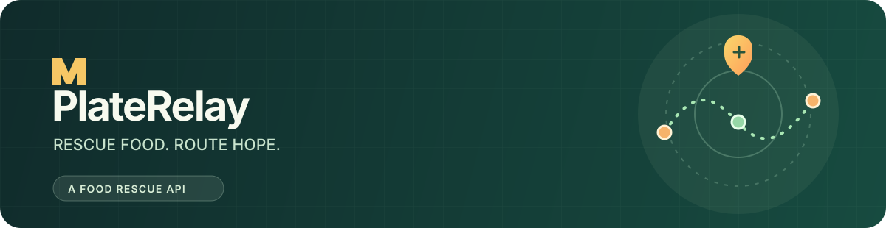
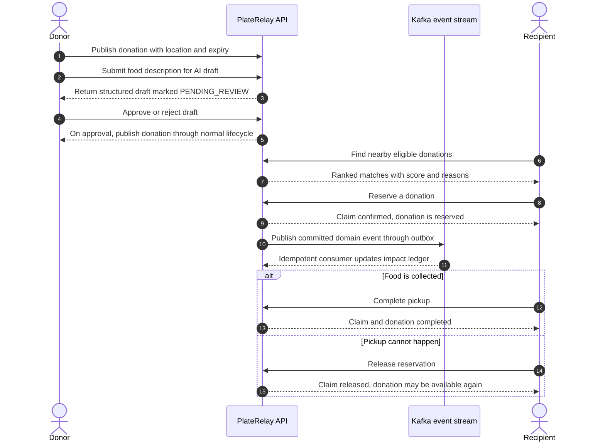
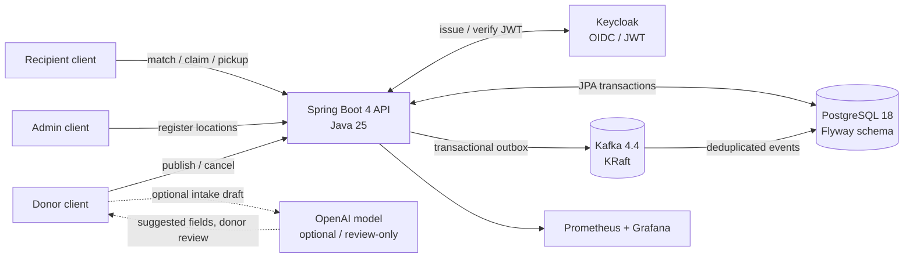
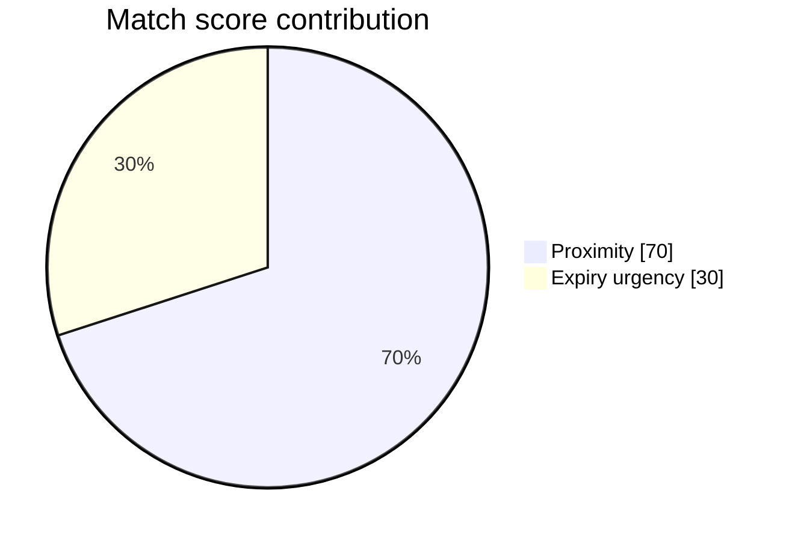
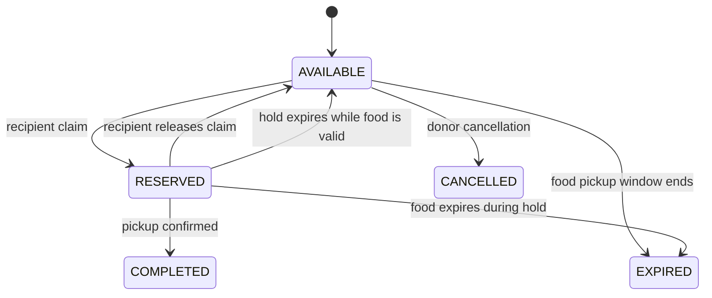

<div align="center">
  
  <h1>PlateRelay</h1>
  <p><strong>A time-sensitive food rescue coordination API.</strong><br />Connect surplus food with nearby community fridges through explainable matching and safe pickup reservations.</p>
  <p>
    
    
    
    
    <a href="https://github.com/rohannsaxena2609/platerelay/actions/workflows/ci.yml"></a>
    
  </p>
</div>

PlateRelay is a food rescue coordination backend. Donors publish time-bounded
surplus lots, recipient organizations discover eligible nearby food, and a
transactional claim flow protects the pickup handoff from double booking. The
upgrade adds a transactional Kafka outbox, an idempotent impact ledger, a
review-only AI intake assistant, and an operational Grafana dashboard.

> **Portfolio focus:** Java 25, Spring Boot 4, PostgreSQL transactions, Kafka
> outbox delivery, OAuth2/JWT authorization, geospatial search, AI safety
> controls, concurrency testing, metrics, and reproducible operations.

## Product flow



## Architecture

PlateRelay is a modular monolith: one Spring Boot API with separated donation,
recipient, matching, and claim domains. PostgreSQL owns durable state and
transaction boundaries. Keycloak issues signed access tokens; the API validates
them as an OAuth2 resource server.



## Engineering highlights

- **Nearby search:** filter candidates with a latitude/longitude bounding box,
  then calculate exact Haversine distance. The search handles date-line and
  near-pole bounds and returns up to 50 ranked matches.
- **Explainable ranking:** score combines proximity (70%) and expiry urgency
  (30% over a 72-hour window). Dietary tags are an eligibility filter. Each
  result includes distance, time to expiry, score, and human-readable reasons.
- **Safe reservations:** a database pessimistic write lock serializes claims
  against the same donation. A claim has a 15-minute hold window, optional
  idempotency key, and explicit completion, release, and expiry outcomes.
- **Lifecycle automation:** scheduled jobs expire available donations and
  release stale reservations. Reservation outcomes respect the donation expiry.
- **Access control:** Keycloak realm roles protect donor, recipient, and admin
  actions. Signed `donor_id` and `recipient_id` claims bind actions to the
  caller’s own identity and resources.
- **Operational visibility:** health and info endpoints, Prometheus metrics,
  structured problem responses, OpenAPI docs, and container health checks.
- **Reliable event delivery:** donation and claim lifecycle events are committed
  to PostgreSQL in the same transaction as the business change. A leased,
  retrying publisher sends them to Kafka; the impact consumer deduplicates by
  event ID, so redelivery does not inflate totals.
- **AI-assisted intake:** optional Spring AI/OpenAI structured suggestions turn
  donor text into a draft. It never publishes automatically or infers dietary
  or allergen safety. The donor must explicitly approve or reject the draft;
  approval requires pickup location and expiry, then publishes through the
  normal donation and transactional outbox flow. Suggestions retain model and
  prompt version for audit; the feature is disabled unless explicitly enabled.
- **Measured operations:** Micrometer exposes matching request/result and
  latency metrics alongside event, outbox, consumer, and standard HTTP metrics.
  The optional Grafana stack provisions a PlateRelay dashboard automatically.
- **Concurrency and persistence tests:** JUnit tests cover matching behavior,
  role mapping, concurrent reservations, idempotency, release/completion,
  stale-claim expiry, outbox writes, and impact-ledger deduplication against
  PostgreSQL 18 via Testcontainers.
- **Load profile:** `load/k6-smoke.js` exercises authenticated browse, publish,
  and match traffic with latency and failure-rate thresholds.

## Challenges & solutions

- **Preventing double claims under concurrency:** two recipients can request the
  same donation at nearly the same time. A PostgreSQL write lock serializes the
  state transition; an optional idempotency key makes safe retries predictable.
- **Keeping database changes and Kafka events consistent:** a database commit
  and a broker publish cannot share one transaction. The transactional outbox
  records the event with the domain change, then a retrying publisher delivers
  it. The consumer deduplicates event IDs so redelivery does not double-count
  impact.
- **Enforcing ownership as well as role:** checking only `DONOR` or `RECIPIENT`
  would let one organization act on another's resources. Write flows also
  compare the signed `donor_id` or `recipient_id` claim with the requested
  resource identity.
- **Making AI useful without letting it publish unsafe data:** free-form food
  descriptions need structured output, but the model must not guess pickup
  details or dietary safety. PlateRelay validates the draft, stores its model
  and prompt version, and requires the owning donor to approve or reject it.
  Approval creates the donation and its outbox event atomically.
- **Handling provider and model changes without coupling the app to one host:**
  the OpenAI-compatible base URL, API key, and model are configured outside the
  image. This lets local development use a gateway such as OmniRoute while
  keeping AI optional and disabled by default.
- **Reproducing database behavior in tests:** persistence, locks, and migrations
  can behave differently from mocks. PostgreSQL Testcontainers run the
  integration tests against a real database, including review, donation
  creation, and outbox persistence.

### Matching score weights

The chart shows the configured contribution to the 100-point ranking score;
dietary compatibility is checked separately as a required filter.



### Donation and claim lifecycle



## Technology

| Area | Technology |
| --- | --- |
| Language and runtime | Java 25 |
| Web and validation | Spring Boot 4, Spring MVC, Jakarta Validation |
| Persistence | Spring Data JPA, PostgreSQL 18, Flyway |
| Identity and access | Keycloak, OAuth2 Resource Server, JWT |
| API documentation | OpenAPI 3, Springdoc, Swagger UI |
| Operations | Spring Actuator, Micrometer Prometheus registry |
| Event processing | Apache Kafka 4.4, transactional outbox, idempotent impact consumer |
| AI-assisted intake | Spring AI 2, OpenAI structured output (optional, human-reviewed) |
| Monitoring | Prometheus, Grafana (optional Compose profile) |
| Testing | JUnit 5, Mockito, Spring Security Test, Testcontainers PostgreSQL |
| Local environment | Docker Compose, multi-stage Docker image |
| Continuous integration | GitHub Actions, Maven `verify` |

## API surface

All endpoints are under `/api/v1` and require a bearer access token.

| Method | Endpoint | Purpose | Required role / identity |
| --- | --- | --- | --- |
| `GET` | `/recipients` | List pickup locations | Any authenticated user |
| `POST` | `/recipients` | Register a pickup location | `ADMIN` |
| `GET` | `/recipients/{id}` | Read a pickup location | Any authenticated user |
| `GET` | `/donations?page=0&size=20` | Browse available donations, soonest expiry first | Any authenticated user |
| `POST` | `/donations` | Publish a time-bounded donation | `DONOR`; donor ID must match token |
| `GET` | `/donations/{id}` | Read donation and lifecycle status | Any authenticated user |
| `POST` | `/donations/{id}/cancel` | Cancel an available donation | `DONOR`; owner only |
| `GET` | `/matches` | Match by coordinates and optional dietary tags | Any authenticated user |
| `GET` | `/matches/recipients/{recipientId}` | Match for recipient’s saved location and tags | `RECIPIENT`; own recipient ID only |
| `POST` | `/donations/intake/suggestions` | Create an AI-assisted donation draft for review | `DONOR`; requires AI opt-in and API key |
| `POST` | `/donations/intake/suggestions/{id}/review` | Approve and publish a draft, or reject it | `DONOR`; suggestion owner only |
| `POST` | `/donations/{donationId}/claims` | Reserve an available donation | `RECIPIENT`; own recipient ID only |
| `POST` | `/claims/{claimId}/complete` | Confirm pickup | `RECIPIENT`; claim owner only |
| `POST` | `/claims/{claimId}/release` | Release a reservation | `RECIPIENT`; claim owner only |

Browse the interactive contract at `http://localhost:8080/swagger-ui/index.html`
after starting the stack. More request and response details are in
[`docs/API.md`](docs/API.md).

## Run locally

### Prerequisites

- Docker Desktop with Docker Compose
- `curl`, `jq`, and Python 3 to run the full demo script

### Start the stack

```bash
git clone https://github.com/rohannsaxena2609/platerelay.git
cd platerelay
docker compose up --build -d
```

Docker Compose starts PostgreSQL, Keycloak, Kafka (KRaft), and the API. The API
waits for the database, identity service, and broker health checks before
starting. The AI helper is off by default. To enable it, set the following in
the project root `.env` file before starting Compose (keep this file private):

```dotenv
PLATERELAY_AI_ENABLED=true
OPENAI_API_KEY=<provider-or-gateway-key>
SPRING_AI_OPENAI_BASE_URL=http://host.docker.internal:20128
SPRING_AI_OPENAI_CHAT_OPTIONS_MODEL=<model-id-from-your-gateway>
```

The base URL and model can target an OpenAI-compatible gateway such as
OmniRoute; use the model ID shown by that gateway. With no gateway configured,
the defaults target OpenAI. Provider usage may incur charges or have free-tier
limits.

| Service | Local URL |
| --- | --- |
| Swagger UI | <http://localhost:8080/swagger-ui/index.html> |
| OpenAPI JSON | <http://localhost:8080/v3/api-docs> |
| API health | <http://localhost:8080/actuator/health> |
| Prometheus metrics | <http://localhost:8080/actuator/prometheus> |
| Impact activity summary | <http://localhost:8080/api/v1/impact/summary> (bearer token required) |
| Keycloak realm | <http://localhost:9090/realms/platerelay> |
| Kafka host listener | `localhost:9092` |

### Run the complete demo

```bash
./scripts/demo.sh
```

The script creates a nearby donation, discovers the recipient match, reserves
it, and completes the pickup. It prints the generated donation and claim IDs
and the match score/reasons. Demo credentials are local-development only; do
not reuse them outside this environment. The script accepts
`PLATERELAY_*_USER` and `PLATERELAY_*_PASSWORD` environment overrides.

### Run monitoring

```bash
docker compose --profile monitoring up -d
```

Open <http://localhost:3000> and sign in with the local-only credentials
`admin` / `admin`. Prometheus is available at <http://localhost:9091>.

### Run the k6 smoke load

The stack and demo recipient must be running. Run with Docker Desktop on macOS:

```bash
docker run --rm -e PLATERELAY_API_URL=http://host.docker.internal:8080 -e PLATERELAY_IDENTITY_URL=http://host.docker.internal:9090 -v "$PWD/load:/load:ro" grafana/k6 run /load/k6-smoke.js
```

To stop the services while keeping database data:

```bash
docker compose down
```

## Matching model

For the coordinate-based endpoint:

1. A bounding-box database query narrows the available, unexpired candidates.
2. Haversine distance removes points outside the requested radius.
3. Required dietary tags filter out incompatible donations.
4. Remaining results are scored and sorted by score, then earliest expiry.

The proximity contribution is `70 × (1 − distance / radius)`. The urgency
contribution is `30 × (1 − min(minutesToExpiry, 4320) / 4320)`. The rounded
sum is the 0–100 score. Recipient-based matching loads the recipient’s
coordinates and dietary tags from its registered profile.

## Project layout

```text
src/main/java/dev/platerelay/
├── donation/       Donation API, persistence, lifecycle, expiry job
├── recipient/      Pickup locations, capacity, dietary preferences
├── matching/       Candidate search, Haversine distance, ranking
├── claim/          Reservation, completion, release, expiry job
├── events/         Transactional outbox, Kafka consumer, impact summary
├── intake/         Optional AI-assisted donor draft with human review
└── platform/       Security, OpenAPI, time, API error handling
src/main/resources/db/migration/   Versioned PostgreSQL schema
monitoring/                         Prometheus config and Grafana dashboard
load/                               k6 authenticated smoke-load script
keycloak/                           Local realm and demo identities
scripts/demo.sh                     End-to-end API walkthrough
docs/                               Product brief and API guide
```

## CI and build

GitHub Actions runs Maven `verify` on pushes and pull requests to `main`, using
Temurin Java 25. For the full local unit and PostgreSQL integration suite, run
with Java 25 and Docker Desktop available:

```bash
mvn --batch-mode --no-transfer-progress clean verify
```

## Further reading

- [Product brief](docs/PRODUCT.md)
- [API guide](docs/API.md)
- [GitHub Actions workflow](.github/workflows/ci.yml)

## License

MIT. See [`LICENSE`](LICENSE).
