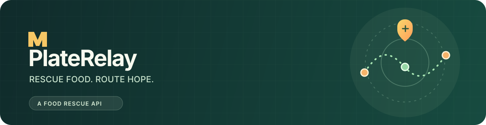
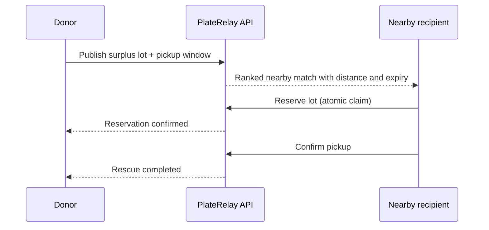

<div align="center">
  
  <br />
  <p><strong>The real-time food rescue API.</strong><br />Move surplus meals from local businesses to the people and community fridges that can use them.</p>
  <p>
    
    
    
    <a href="https://github.com/rohannsaxena2609/platerelay/actions/workflows/ci.yml"></a>
    
  </p>
</div>

## Why PlateRelay?

Every day, good food expires while a community fridge nearby sits empty.
PlateRelay turns that timing problem into a coordination problem the backend
can solve: publish a surplus lot, discover nearby matches, reserve it safely,
and confirm the handoff before the pickup window closes.

### At a glance

| Capability | What it does |
| --- | --- |
| **Live listings** | Browse available donations in bounded pages ordered by soonest expiry. |
| **Explainable matching** | Rank recipient opportunities by proximity and urgency with transparent match reasons. |
| **Safe reservations** | Atomic claim transitions prevent two recipients from collecting the same lot. |
| **Expiry lifecycle** | Scheduled cleanup closes expired offers and releases stale reservations. |
| **Built for operations** | PostgreSQL, Flyway, Docker Compose, health checks, metrics, and OpenAPI. |

## The rescue loop



## Tech stack

- Java 25 LTS and Spring Boot 4
- Spring MVC, Jakarta Validation, Spring Data JPA
- PostgreSQL with Flyway migrations
- Spring Security resource-server support
- OpenAPI 3, Actuator, Micrometer / Prometheus
- Docker Compose for local development

## Quick start

> Prerequisites: Docker and Docker Compose. The container build uses JDK 25.

```bash
git clone https://github.com/rohannsaxena2609/platerelay.git
cd platerelay
docker compose up --build
```

The API will be available at `http://localhost:8080`. Interactive API docs are
at `http://localhost:8080/swagger-ui.html`; health is at
`http://localhost:8080/actuator/health`. Local identity is seeded in Keycloak at
`http://localhost:9090` with donor, recipient, and admin demo users. Their local
passwords are intentionally for development only.

Run the full publish → match → reserve → pickup flow after the services start:

```bash
./scripts/demo.sh
```

The script uses `curl`, `jq`, and Python 3. Override its local demo credentials
with the `PLATERELAY_*_USER` and `PLATERELAY_*_PASSWORD` environment variables.

Get a local donor token, then use the Swagger UI **Authorize** button or send it
as a bearer token:

```bash
curl -s http://localhost:9090/realms/platerelay/protocol/openid-connect/token \
  -d client_id=platerelay-cli \
  -d grant_type=password \
  -d username=donor-dev \
  -d password=donor-local-2026
```

The local admin registers recipients; recipient users discover and claim food.
For the complete API contract, roles, request fields, and lifecycle, see
[the API guide](docs/API.md).

## API preview

```http
POST /api/v1/donations
Authorization: Bearer <donor-token>
Content-Type: application/json

{
  "donorId": "market-17",
  "title": "Fresh vegetable boxes",
  "description": "Seasonal produce packed this afternoon",
  "quantity": 12,
  "unit": "BOX",
  "availableUntil": "2026-10-28T18:30:00Z",
  "pickup": { "latitude": 12.9716, "longitude": 77.5946 },
  "dietaryTags": ["VEGAN", "GLUTEN_FREE"]
}
```

```http
GET /api/v1/matches?latitude=12.9716&longitude=77.5946&radiusKm=8
POST /api/v1/donations/{donationId}/claims
Authorization: Bearer <recipient-token>
Idempotency-Key: a-unique-request-id
POST /api/v1/claims/{claimId}/complete
Authorization: Bearer <recipient-token>
```

## Project map

```text
src/main/java/.../platerelay
├── donation/       listing and donation lifecycle
├── recipient/      pickup locations and capacity
├── matching/       geo-aware, explainable ranking
├── claim/          atomic reservation and handoff
└── platform/       persistence, errors, security, observability
```

See [the product brief](docs/PRODUCT.md) and [the API contract](docs/API.md).

## Roadmap

- [x] Product brief, domain boundaries, and API sketch
- [x] Spring Boot foundation and local database
- [x] Donation and recipient workflows
- [x] Geo-aware match ranking and atomic claims
- [x] Security, observability, and API documentation
- [x] Containerized local run and CI

## License

MIT. See [LICENSE](LICENSE).

