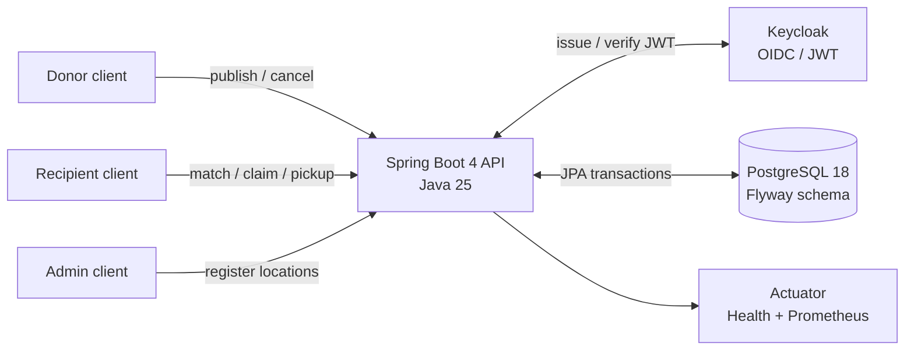
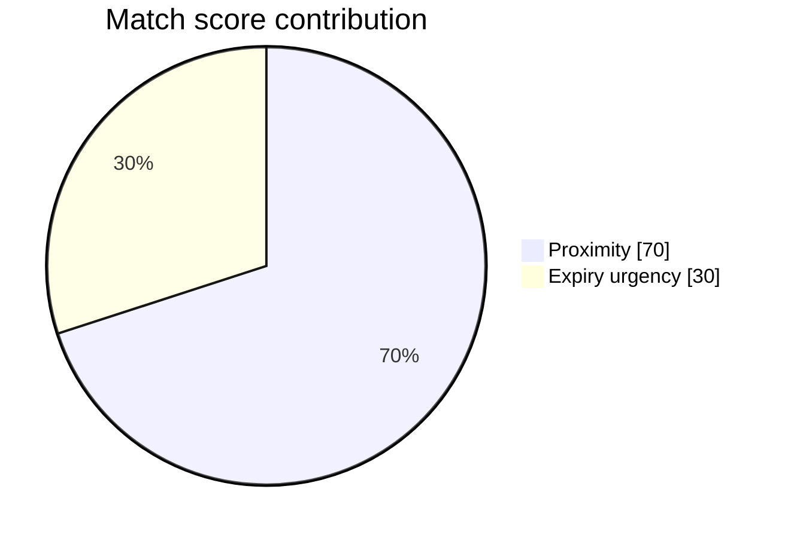
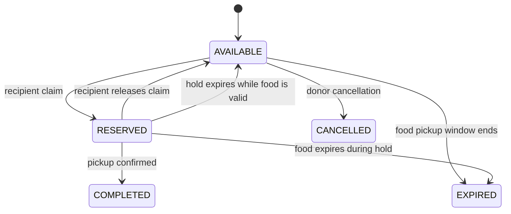

<div align="center">
  
  <h1>PlateRelay</h1>
  <p><strong>A time-sensitive food rescue coordination API.</strong><br />Connect surplus food with nearby community fridges through explainable matching and safe pickup reservations.</p>
  <p>
    
    
    
    
    <a href="https://github.com/rohannsaxena2609/platerelay/actions/workflows/ci.yml"></a>
    
  </p>
</div>

PlateRelay is a backend for food rescue workflows. Donors publish time-bounded
surplus lots, recipient organizations discover eligible nearby food, and a
transactional claim flow protects the pickup handoff from double booking.

> **Portfolio focus:** modular backend design, OAuth2/JWT authorization,
> geospatial candidate filtering, explainable ranking, transactional state
> changes, idempotent requests, scheduled expiry, and a reproducible Docker
> development environment.

## Product flow

```mermaid
sequenceDiagram
    autonumber
    actor Donor
    participant API as PlateRelay API
    actor Recipient
    Donor->>API: Publish donation with location and expiry
    Recipient->>API: Find nearby eligible donations
    API-->>Recipient: Ranked matches with score and reasons
    Recipient->>API: Reserve a donation
    API-->>Recipient: Claim confirmed; donation is reserved
    alt Food is collected
        Recipient->>API: Complete pickup
        API-->>Recipient: Claim and donation completed
    else Pickup cannot happen
        Recipient->>API: Release reservation
        API-->>Recipient: Claim released; donation may be available again
    end
```

## Architecture

PlateRelay is a modular monolith: one Spring Boot API with separated donation,
recipient, matching, and claim domains. PostgreSQL owns durable state and
transaction boundaries. Keycloak issues signed access tokens; the API validates
them as an OAuth2 resource server.



## Engineering highlights

- **Nearby search:** filter candidates with a latitude/longitude bounding box,
  then calculate exact Haversine distance. The search handles date-line and
  near-pole bounds and returns up to 50 ranked matches.
- **Explainable ranking:** score combines proximity (70%) and expiry urgency
  (30% over a 72-hour window). Dietary tags are an eligibility filter. Each
  result includes distance, time to expiry, score, and human-readable reasons.
- **Safe reservations:** a database pessimistic write lock serializes claims
  against the same donation. A claim has a 15-minute hold window, optional
  idempotency key, and explicit completion, release, and expiry outcomes.
- **Lifecycle automation:** scheduled jobs expire available donations and
  release stale reservations. Reservation outcomes respect the donation expiry.
- **Access control:** Keycloak realm roles protect donor, recipient, and admin
  actions. Signed `donor_id` and `recipient_id` claims bind actions to the
  caller’s own identity and resources.
- **Operational visibility:** health and info endpoints, Prometheus metrics,
  structured problem responses, OpenAPI docs, and container health checks.

### Matching score weights

The chart shows the configured contribution to the 100-point ranking score;
dietary compatibility is checked separately as a required filter.



### Donation and claim lifecycle



## Technology

| Area | Technology |
| --- | --- |
| Language and runtime | Java 25 |
| Web and validation | Spring Boot 4, Spring MVC, Jakarta Validation |
| Persistence | Spring Data JPA, PostgreSQL 18, Flyway |
| Identity and access | Keycloak, OAuth2 Resource Server, JWT |
| API documentation | OpenAPI 3, Springdoc, Swagger UI |
| Operations | Spring Actuator, Micrometer Prometheus registry |
| Local environment | Docker Compose, multi-stage Docker image |
| Continuous integration | GitHub Actions, Maven `verify` |

## API surface

All endpoints are under `/api/v1` and require a bearer access token.

| Method | Endpoint | Purpose | Required role / identity |
| --- | --- | --- | --- |
| `GET` | `/recipients` | List pickup locations | Any authenticated user |
| `POST` | `/recipients` | Register a pickup location | `ADMIN` |
| `GET` | `/recipients/{id}` | Read a pickup location | Any authenticated user |
| `GET` | `/donations?page=0&size=20` | Browse available donations, soonest expiry first | Any authenticated user |
| `POST` | `/donations` | Publish a time-bounded donation | `DONOR`; donor ID must match token |
| `GET` | `/donations/{id}` | Read donation and lifecycle status | Any authenticated user |
| `POST` | `/donations/{id}/cancel` | Cancel an available donation | `DONOR`; owner only |
| `GET` | `/matches` | Match by coordinates and optional dietary tags | Any authenticated user |
| `GET` | `/matches/recipients/{recipientId}` | Match for recipient’s saved location and tags | `RECIPIENT`; own recipient ID only |
| `POST` | `/donations/{donationId}/claims` | Reserve an available donation | `RECIPIENT`; own recipient ID only |
| `POST` | `/claims/{claimId}/complete` | Confirm pickup | `RECIPIENT`; claim owner only |
| `POST` | `/claims/{claimId}/release` | Release a reservation | `RECIPIENT`; claim owner only |

Browse the interactive contract at `http://localhost:8080/swagger-ui/index.html`
after starting the stack. More request and response details are in
[`docs/API.md`](docs/API.md).

## Run locally

### Prerequisites

- Docker Desktop with Docker Compose
- `curl`, `jq`, and Python 3 to run the full demo script

### Start the stack

```bash
git clone https://github.com/rohannsaxena2609/platerelay.git
cd platerelay
docker compose up --build -d
```

Docker Compose starts PostgreSQL, Keycloak, and the API. The API waits for the
database and identity service health checks before starting.

| Service | Local URL |
| --- | --- |
| Swagger UI | <http://localhost:8080/swagger-ui/index.html> |
| OpenAPI JSON | <http://localhost:8080/v3/api-docs> |
| API health | <http://localhost:8080/actuator/health> |
| Prometheus metrics | <http://localhost:8080/actuator/prometheus> |
| Keycloak realm | <http://localhost:9090/realms/platerelay> |

### Run the complete demo

```bash
./scripts/demo.sh
```

The script creates a nearby donation, discovers the recipient match, reserves
it, and completes the pickup. It prints the generated donation and claim IDs
and the match score/reasons. Demo credentials are local-development only; do
not reuse them outside this environment. The script accepts
`PLATERELAY_*_USER` and `PLATERELAY_*_PASSWORD` environment overrides.

To stop the services while keeping database data:

```bash
docker compose down
```

## Matching model

For the coordinate-based endpoint:

1. A bounding-box database query narrows the available, unexpired candidates.
2. Haversine distance removes points outside the requested radius.
3. Required dietary tags filter out incompatible donations.
4. Remaining results are scored and sorted by score, then earliest expiry.

The proximity contribution is `70 × (1 − distance / radius)`. The urgency
contribution is `30 × (1 − min(minutesToExpiry, 4320) / 4320)`. The rounded
sum is the 0–100 score. Recipient-based matching loads the recipient’s
coordinates and dietary tags from its registered profile.

## Project layout

```text
src/main/java/dev/platerelay/
├── donation/       Donation API, persistence, lifecycle, expiry job
├── recipient/      Pickup locations, capacity, dietary preferences
├── matching/       Candidate search, Haversine distance, ranking
├── claim/          Reservation, completion, release, expiry job
└── platform/       Security, OpenAPI, time, API error handling
src/main/resources/db/migration/   Versioned PostgreSQL schema
keycloak/                           Local realm and demo identities
scripts/demo.sh                     End-to-end API walkthrough
docs/                               Product brief and API guide
```

## CI and build

GitHub Actions runs Maven `verify` on pushes and pull requests to `main`, using
Temurin Java 25. For a local package build, run:

```bash
mvn --batch-mode --no-transfer-progress verify
```

## Further reading

- [Product brief](docs/PRODUCT.md)
- [API guide](docs/API.md)
- [GitHub Actions workflow](.github/workflows/ci.yml)

## License

MIT. See [`LICENSE`](LICENSE).
